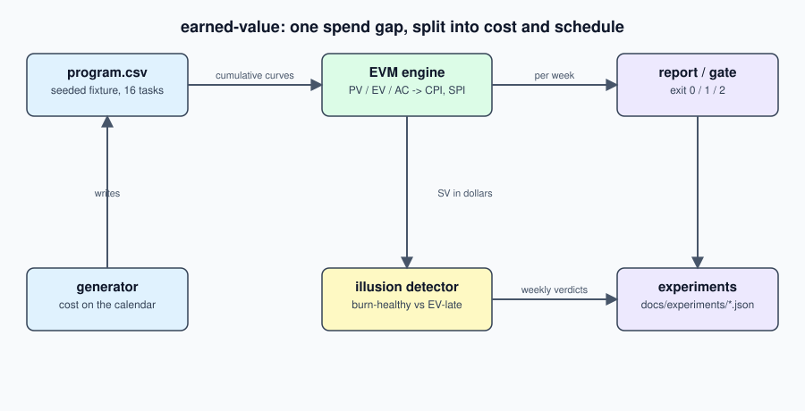
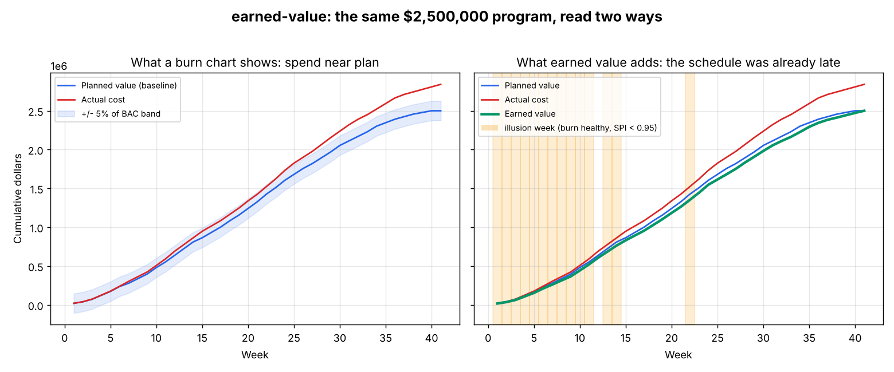

# earned-value

**Reads a delivery program week by week and splits the one number a burn chart shows (spend
versus plan) into the two it hides: a cost effect and a schedule effect. On a seeded $2,500,000
program it finds the 14 reporting weeks where spend sat within 5% of budget while the schedule was
already late, and prices the worst concealed slip at $73,506.**

[](https://github.com/Venkata-Pramid-Reddy-Mitta/earned-value/actions/workflows/ci.yml)


## The question a burn chart cannot answer

A burn chart plots one actual-cost line against one planned-cost line. The gap between them is a
single number, and a single number cannot say which of two very different things is happening:

1. Is the program **under budget** because the team is efficient, or **behind schedule** because
   the work simply has not been done yet? Both pull actual cost below the plan.
2. When spend is reported as "within 5% of budget", is that health, or is it the calendar paying a
   team on time while the deliverables slip?
3. At any given week, how many budget dollars of scheduled work have not yet been earned, a figure a
   burn chart never plots?
4. Near the finish, can the schedule read be trusted at all?

This tool adds the third measure a burn chart leaves out, **earned value**, which splits the spend
gap exactly:

```text
actual_cost - planned_value = (schedule_variance) - (cost_variance)
```

## The uncomfortable numbers

On the committed fixture, a staffed $2,500,000 program over a 40 week baseline:

- **14 reporting weeks** read healthy on spend (actual cost within 5% of the planned baseline) while
  SPI was already below 0.95. The worst of them concealed **$73,506** of scheduled-but-unearned work
  at **week 22**.
- The program finished **$339,975** over budget, **13.6%** of the budget, at a **CPI of 0.880**. The
  independent cost forecast (EAC) was within 5% of the final cost by week 1, long before the burn
  chart's gap grew wide enough to notice.
- The tool's own blind spot, published rather than hidden: **SPI recovers to 0.989** at the planned
  end and reads an exact **SPI of 1.000** at completion, even though the program finished late in
  week 41. The schedule index goes blind at the finish; the cost index does not.

Every figure above and below is produced by code that ran in this build and is re-checked by CI:
**87 tests**, **99% line coverage**, and `tools/check_numbers.py` fails the build if any document
quotes a figure the code no longer produces.

## Quickstart

Prerequisites: Python 3.10 or newer, and `make`. No network, no API keys.

```bash
pip install -e ".[dev,viz]"

# the headline: weeks the burn read healthy while earned value read late
python -m earned_value.cli illusions

# the full re-measure, lint, tests, and number check, from a clean clone
make verify
```

`make verify` runs lint, the test suite, re-measures every published number from the committed
fixture, and fails if a document has drifted. It needs no network.

## What each claim rests on

### The spend gap decomposes into schedule and cost

| Quantity | Definition | Final week |
|---|---|---|
| Planned value (PV) | budgeted cost of work scheduled by now | $2,500,000 |
| Earned value (EV) | budgeted cost of work actually completed | $2,500,000 |
| Actual cost (AC) | money actually spent | $2,839,975 |
| Cost variance (CV) | EV - AC | negative, over cost |
| Schedule variance (SV) | EV - PV | negative until the finish |

The identity `actual_cost - planned_value == schedule_variance - cost_variance` holds every week to a
**maximum residual of 0.00** dollars. That is what lets the single burn gap be attributed: the part
that is schedule and the part that is cost.

### Spend within 5% of budget is not the same as healthy

The illusion is a true statement standing in for a false one. For **14 reporting weeks** a status
report could say "spend is within 5% of budget" and be correct, while the schedule performance index
had already crossed below 0.95. The size of the illusion in each week is the schedule variance: the
budgeted value of work the baseline promised and the team had not earned. The worst single week hid
**$73,506** of scheduled work at **week 22**.

The mechanism is not exotic. On a staffed program, cost accrues on the calendar (the team is paid
for the weeks it is engaged) while value accrues on deliverables. When productivity runs below plan,
the team still costs what it costs, so spend keeps tracking the baseline while earned value falls
behind. See [ADR-002](docs/adr/ADR-002-time-driven-cost-vs-deliverable-value.md).

### The cost forecast saw the overrun the burn chart did not

Because CPI is roughly flat from the first weeks, the independent estimate at completion
(EAC = BAC / CPI) forecast the final cost early: it was **within 5% of the final cost by week 1**.
The program ended **$339,975** over budget, a **13.6%** overrun, with **CPI stays at 0.880** to the
finish. A burn chart's gap did not open visibly until the second half of the program, by which point
most of the budget was committed.

### What it costs against what it buys

| | The burn chart alone | Adding earned value |
|---|---|---|
| Reads spend vs plan | yes | yes |
| Separates behind-schedule from efficient | no | yes |
| Prices unearned scheduled work in dollars | no | yes, SV per week |
| Trustworthy near completion | SPI is not (see below) | needs Earned Schedule |
| Inputs required | cost actuals | cost actuals plus a percent-complete per task |

The cost of earned value is the extra input: someone must assess percent complete per task honestly.
The boundary section below says where even that is not enough.

## The bugs the measurement found

**The fixture round-trip lost a fraction of a cent.** The committed fixture is written to a CSV at six
decimal places, and an early check asserted that the reloaded program earned exactly `2_500_000`
dollars. It did not: the reloaded total came back off by about `1.1e-05` dollars, because sixteen
tasks each rounded to six places and the roundings did not cancel. The equality assertion went red
over a thousandth of a cent. The fix was to price money in the fixture as the decimal it is and assert
a cent-level tolerance, not exact float equality. The lesson is pinned permanently by
`test_the_csv_round_trip_needs_a_cent_tolerance`, which asserts both that the exact check is wrong and
that the tolerance is right.

**The number checker flagged a figure that was correct.** The reverse check scans the documents for
dollar amounts and fails on any the code does not produce. It is a regex, and the regex for a dollar
amount reads `$2.5` out of the string `$2.5M`, stops at the `M`, and reports `$2.5` as an unbacked
figure, failing the build on a sentence that was perfectly correct. The fix was to drop the ambiguous
millions shorthand from the guarded set and state the budget only as its exact comma figure, so every
dollar the checker sees is one it can trace. The episode is the reason the receipts guard anchor
phrases (a number plus a few words) rather than raw digits.

## Architecture



Diagram source (rendered to the committed SVG by `tools/render_diagram.py`):

```text
program.csv (seeded fixture)  ->  EVM engine (PV/EV/AC -> CPI, SPI, EAC)  ->  report / gate (exit 0/1/2)
generator (cost on calendar)  ->  program.csv
EVM engine                    ->  illusion detector (burn-healthy vs EV-late)  ->  experiments (JSON)
```

## Evidence



Both panels are drawn from the committed fixture by `tools/make_evidence.py`. The left panel is the
burn chart a status report shows. The right panel adds earned value and shades the illusion weeks.
`docs/evidence/manifest.json` is a replay manifest: the five demo commands actually run, each with
its real exit code and measured wall time.

## The fixture

`data/program.csv` is one deterministic run of the seeded generator: **16 tasks** across
**4 workstreams** (cloud migration, app modernization, data migration, testing and deployment),
budgets summing to **$2,500,000** over a **40 week baseline**. The awkward cases are deliberate: the
cloud workstream runs close to plan while the two build-heavy workstreams run below plan, so the
program is neither uniformly healthy nor uniformly failing. The slip tails spill past week 40, which
is what makes the SPI blindness measurable.

## What this cannot measure

This is a section, not a footnote.

- **SPI goes blind near completion.** Earned value over planned value both converge on the budget as
  the work finishes, so SPI returns toward 1.0 regardless of how late the finish is. Here the
  **SPI trough 0.883** at week 3 recovers to **0.989** at the planned end and an exact
  **SPI of 1.000** at completion in **week 41**, a week past the baseline. CPI shows no such recovery.
  The honest schedule read in the final weeks needs Earned Schedule (time units, not dollars), which
  this repository deliberately does not implement. See
  [ADR-003](docs/adr/ADR-003-spi-blindness-boundary.md).
- **The program is synthetic.** The generator encodes one scenario (a productivity shortfall on a
  staffed program) and the engine reports whatever that scenario produces. Against a real program the
  arithmetic would be identical; only the inputs change. The one input this tool declares rather than
  observes is percent complete per task, which in a real program is a human judgment and the main way
  earned value is gamed. See [ADR-004](docs/adr/ADR-004-fixture-and-determinism-boundary.md).

## Layout, exit codes, reproduction

```text
src/earned_value/   model, evm engine, generator, illusion detector, cli, config
data/program.csv    the committed, seeded fixture
experiments/        four runnable experiments writing JSON to docs/experiments/
tools/              collect_metrics, check_numbers, render_diagram, make_evidence
docs/               adr/, experiments/, evidence/, metrics.json, defense-guide.md
```

The CLI exit codes separate "the tool answered no" from "the tool could not answer":

| Code | Meaning |
|---|---|
| 0 | the week is healthy on both reads |
| 1 | the week is flagged: behind schedule or over cost |
| 2 | the tool could not answer: bad arguments or a malformed fixture |

Make targets: `make lint`, `make test`, `make experiments`, `make evidence`, `make receipts`, and
`make verify` (lint, test, receipts). `make regen` rebuilds the fixture and is deliberately not part
of `verify`, because the published numbers are reproduced from the committed `data/program.csv`, not
from a fresh draw. `tools/check_numbers.py` guards figures by matching anchor phrases (the number and
a few surrounding words) rather than bare digits, so a stale sentence fails the build while an example
in a code block does not.

## Tech stack

| Technology | Role here | Why this choice |
|---|---|---|
| Python 3.10+ | engine, CLI, tooling | standard library plus two numeric packages keeps the runtime offline |
| pandas | not required by the engine; available for analysis | a direct extension of the spreadsheet and Power BI modeling a delivery PM already does |
| numpy | the seeded generator's random draws | one reproducible bit generator makes the fixture deterministic |
| matplotlib | the evidence chart only (the `viz` extra) | build-time only, never imported by the metrics path, so the no-extras CI job proves the tool runs without it |
| pytest, pytest-cov | tests and measured coverage | coverage is read from the machine report, not claimed |
| ruff | lint at 100 columns | one fast tool for style and import order |

Architecture decisions:

- [ADR-001: earned value over a burn-up of spend](docs/adr/ADR-001-earned-value-over-burn-up.md)
- [ADR-002: time-driven cost versus deliverable-driven value](docs/adr/ADR-002-time-driven-cost-vs-deliverable-value.md)
- [ADR-003: the SPI blindness boundary](docs/adr/ADR-003-spi-blindness-boundary.md)
- [ADR-004: fixture and determinism boundary](docs/adr/ADR-004-fixture-and-determinism-boundary.md)
- [ADR-005: exit codes that distinguish no from cannot-answer](docs/adr/ADR-005-exit-codes.md)

## The Pivot and future work

**Out of scope on purpose: Earned Schedule.** Measuring schedule variance in time units rather than
dollars is the known fix for SPI's end-of-program blindness. It is deliberately not built here.
Trigger to add it: when a stakeholder needs a trustworthy schedule read in the final stretch of a
program, where SPI is structurally unreliable (ADR-003).

A v2 would also need: per-task percent-complete methods beyond linear (0/100, weighted milestones), a
loader for a real Azure DevOps or MS Project export in place of the generator, and confidence bands on
EAC rather than a single point forecast. The first metric to watch when any of these lands is whether
the illusion-week count and the worst concealed slip move, because those are the figures the whole
tool exists to produce.
